# JDsearch: query-conditioned two-tower retrieval + LambdaRank re-ranking

BT4222 group project. Given a user's search query on JD.com, the items JD displayed for it and the user's past
behaviour, rank the displayed items so the ones the user clicks, adds to cart or buys come first.
Dataset: **JDsearch** (Liu et al., SIGIR 2023, <https://github.com/rucliujn/JDsearch>).

The pipeline replaces the previous team's Hybrid NCF + LSTM with:

1. a **two-tower model**: an *item tower* that encodes product content (title/brand/category terms, ids,
   popularity), and a *query + user tower* that encodes the search query together with the user's history,
   scored by cosine similarity;
2. a **LightGBM LambdaRank re-ranker** that combines the tower score with ~100 hand-crafted features.

Everything runs from the command line (`scripts/`); the two notebooks are thin wrappers.

---

## Contents

- [Quick start](#quick-start)
- [How the pipeline works](#how-the-pipeline-works)
- [Design decisions](#design-decisions)
- [Stages, outputs and running times](#stages-outputs-and-running-times)
- [Configuration](#configuration)
- [Repository layout](#repository-layout)
- [Troubleshooting](#troubleshooting)

---

## Quick start

**Needs:** Linux with an NVIDIA GPU (≥ 16 GB VRAM recommended, see [Troubleshooting](#troubleshooting) for smaller GPUs),
≥ 32 GB RAM, ~20 GB free disk, Python 3.11 or 3.12. The scripts also run on CPU / Apple Silicon (slowly for the tower).

```bash
git clone https://github.com/yushanedi/bt4222-two-tower-recsys.git
cd bt4222-two-tower-recsys
python3 -m venv .venv
source .venv/bin/activate
```

Install PyTorch for your CUDA version first (pick the command at <https://pytorch.org/get-started/locally/>), e.g.

```bash
pip install torch --index-url https://download.pytorch.org/whl/cu124
```

then everything else:

```bash
pip install -r requirements.txt
```

Check that the GPU is visible:

```bash
python -c "import torch; print(torch.cuda.is_available(), torch.cuda.get_device_name(0))"
```

**Data.** Put the two raw files in `data/raw/` (they are not in git; see [data/raw/README.md](data/raw/README.md)):

```
data/raw/user_behavior_data.txt     0.96 GB
data/raw/product_meta_data.txt      4.84 GB
```

**1. Smoke test first** (CPU, ~1 min to parse the raw files once, then ~1 min). Runs the unit tests and every stage on a
2,000-user sample with tiny models. Its metrics are meaningless; it only proves the code runs on your machine.

```bash
bash scripts/smoke_test.sh
```

It must end with `SMOKE TEST PASSED`.

**2. Full run** (all 173,831 users):

```bash
bash scripts/run_all.sh configs/default.yaml 2>&1 | tee run_full.log
```

Every stage skips work whose outputs already exist, so after a crash just re-run the same command. To redo a single
stage add `--force` to that script, e.g. `python scripts/05_train_ranker.py --force`.

**3. Results.** The final comparison table is `outputs/full/results/summary_test.csv`; open
`notebooks/02_results.ipynb` for tables and figures. To share results, send back `outputs/full/results/`,
`outputs/full/figures/`, `outputs/full/tower/*_history.json` and `run_full.log` (all small); model files and parquet
tables are large and can be regenerated.

---

## How the pipeline works

```mermaid
flowchart TD
    R[("raw files<br/>user_behavior_data.txt<br/>product_meta_data.txt")] --> P["00 prepare<br/>parse, shuffle slates,<br/>split users, folds"]
    P --> E["01 EDA<br/>retention windows,<br/>type mix by age"]
    P --> F["02 features<br/>~105 per (user, item)"]
    F --> B["02b baselines<br/>popularity, CTR, BM25"]
    P --> N["02c prior team's<br/>Hybrid NCF + LSTM"]
    P --> T["03 train two-tower<br/>fold0, fold1 (cross-fit)<br/>+ full"]
    T --> S["04 score tower<br/>out-of-fold for train users,<br/>full model for val / test"]
    F --> K["05 train LambdaRank<br/>train users, early stop on val"]
    S --> K
    K --> X["06 predict<br/>val + test slates"]
    X --> D["07 diagnostics<br/>segments, SHAP,<br/>attention, ablations"]
    B --> X
    N --> X
```



### The task (formulation)

Each of the 173,831 rows of the user file is one search session: a **test query**, the **slate** of items JD displayed
for it (89 on average, up to 200), a label for each displayed item (0 = ignored, 1 = clicked, 2 = added to cart,
3 = purchased) and the user's **history** before the query (item, event type, query it was issued under, time).

We treat it as **query-conditioned re-ranking of the displayed slate** (learning to rank), the official JDsearch
protocol: every model scores every displayed item and is evaluated on the full slate. Users are split 80/10/10 into
train / validation / test (only users with at least one positive are evaluated). Metrics are MRR, P@1 and NDCG@10 (the
paper's), plus graded NDCG@10 (gain 2^label − 1), HR@10 and recall@k.

### The roles of the data fields

| data field | role in the model |
|---|---|
| test query + displayed slate + labels | the supervised task itself (training users' slates are the training signal) |
| the user's own history | personal features and the user side of the query + user tower |
| query-tagged history (all users) | query → item knowledge: what people engage with after a given query |
| history of all users | item / brand / shop / category popularity |
| product metadata (title, brand, category terms) | content: lexical match and the item tower; ~80% of displayed items never occur in any history |
| labels of *other* training users | impression CTR, out-of-fold |

### The history is three logs with different retention windows

Counted back from each user's test query, **clicks are kept only for 7 days, carts and follows for 90 days, orders for
365 days** (99.9% of clicks are < 7 days old; every order is < 365 days old; `01_eda.py` plots this as
`figures/history_timeline.png`). Beyond 7 days, "no click" means "not recorded", not "did not click". So:

- every history count is computed **per event type inside that type's own window** (`click_7`, `cart_7`, `cart_90`,
  `order_7`, `order_90`, `order_365`, `follow_90`) plus *days since the last event*; no mixing of types with decay
  weights, no "click ratio" (it is 95% correlated with how much of a user's history falls in the last week);
- the tower splits the history into three segments, **short (< 7 d, all types), mid (7–90 d, carts/follows/orders),
  long (≥ 90 d, orders only)**, each pooled by its own query-guided attention.

---

## Design decisions

**Leakage control.**
- The raw slate is sorted by label (positives first in 100% of slates). `00_prepare.py` shuffles every slate with a
  fixed seed; the original position is kept only for auditing and is never a feature; ties in evaluation are broken
  randomly.
- History strictly precedes the test query of its own user.
- Labels enter features only as impression CTR, computed **out-of-fold**: a training user in fold *k* sees CTR tables
  built from the other folds; validation/test users see tables built from all training users
  (`tests/test_features.py::test_ctr_is_out_of_fold` flips one user's labels and checks its features do not change).
- **Cross-fitting of the tower**: the ranker learns on training users, so their tower scores come from tower models
  that never saw their slates (`fold0` scores fold 0, trained on fold 1, and vice versa); validation/test users are
  scored by the `full` tower. Otherwise the ranker would learn to trust an over-fitted tower score.

**Two-tower model** (`src/jds/twotower/`).
- *Item tower*: mean term embeddings of title (20 terms), brand (4) and category L3+L4 names (6); embeddings of brand,
  shop and 4 category ids; popularity buckets of clicks (7 d), carts (90 d) and orders (365 d); MLP → 128-d. No item-id
  embedding (most displayed items are cold).
- *Query + user tower*: the query shares the term embedding. Each history event = item tower output + event type +
  log time before the anchor + the query it was issued under. Each segment (short / mid / long, most recent 50 / 30 / 30
  events) is pooled by query-guided attention with a null slot; the segment sizes enter as a feature; MLP → 128-d.
- *Loss*: listwise softmax over each training slate with target ∝ 2^label − 1 (matches the task), plus an auxiliary
  in-batch softmax on historical (query → item) events from the last 7 days (where the earlier history is complete),
  weighted by event type (click 1, cart 2, order 3). Best epoch by validation graded NDCG@10.

**Re-ranker** (`src/jds/ranker/`). LightGBM `lambdarank`, label gain [0, 1, 3, 7], early stopping on validation users,
features from `src/jds/features.py` + the tower score, its within-slate percentile and its gap to the slate's best.

**Feature groups** (`src/jds/features.py`, names by prefix):
`u_*` personal history per key (item, brand, shop, category) and type window + days since last event + carted-not-ordered;
`u_q_*`, `u_simq_*` engagement under the user's earlier queries similar to the test query (Jaccard ≥ 0.5; the exact
test query almost never re-occurs: 1 user in 173,831);
`qpop_*` query → item / brand / category engagement of all users; `ipop_*`, `apop_*` windowed popularity;
`ctr_*`, `gain_*`, `disp_*` out-of-fold impression CTR / graded gain / display rate;
`lex_*` BM25 and query-term coverage; `slate_*` slate composition and within-slate percentiles; `ua_*` user activity;
`item_*` item content.

**Baselines** (`02b`, `02c`): random, windowed popularity, CTR, query-item engagement, BM25, user affinity, a
popularity + BM25 mix (weight chosen on validation), and the previous team's Hybrid NCF + LSTM (as published, with its
attribute-lookup bug, and fixed), evaluated on the same full slates.

---

## Stages, outputs and running times

All outputs go to `outputs/<scope>/` (`full`, or `sample_<N>` for a user subsample).

| script | does | main outputs | time (measured on a 16 GB Apple M-series laptop, CPU) |
|---|---|---|---|
| `00_prepare.py` | parse raw files, shuffle slates, split users, folds; subsample for `sample_*` scopes | `data/*.parquet`, `results/prepare_stats.json` | 1 min |
| `01_eda.py` | retention windows, type mix by age, slate stats, popularity AUC by window | `figures/history_timeline.png`, `results/eda.json` | 10 s |
| `02_features.py` | ~105 features per displayed item, in 20k-user chunks | `features/part_*.parquet` (15.5 M rows) | 17 min, 6 GB RAM peak |
| `02b_baselines.py` | non-learned baselines | `results/baselines.json` | 5 s |
| `02c_prior_ncf.py` | previous team's model (2 variants × 3 epochs) | `results/prior_ncf.json` | GPU: est. 10–20 min |
| `03_train_tower.py` | 3 towers (`fold0`, `fold1`, `full`) × 3 epochs ≈ 13k steps; first builds the item matrix (12.3 M items, ~2 min) | `tower/assets.npz`, `tower/*.pt`, `tower/*_history.json` | GPU: est. 30–90 min (not measured; 1.7 s/step on laptop CPU) |
| `04_score_tower.py` | cross-fitted scores for all 15.5 M displayed items | `tower/tower_scores.parquet`, `results/tower.json` | GPU: est. 5–10 min |
| `05_train_ranker.py` | LambdaRank on ~137k training slates | `ranker/ranker.txt`, `results/ranker_feature_importance.csv` | CPU: est. 10–30 min, ~15 GB RAM |
| `06_predict.py` | re-rank val/test, final table | `predictions/ranker_{val,test}.parquet`, `results/ranker.json`, `results/summary_test.csv` | ~1 min |
| `07_diagnostics.py` | segments, SHAP, tower attention (+ `--parts ablations`: 11 rankers on 30% of users) | `results/diag_*`, `figures/diag_shap.png` | ~5 min (+ ~1 h with ablations) |

Measured sanity check at full scale (CPU, no tower): a features-only ranker trained on 25% of the training users
reaches test MRR 0.455 / NDCG@10 0.454, against 0.344 / 0.353 for the best non-learned baseline
(popularity). The full run (all users, plus the tower score) should match or beat this; if
it does not, something is wrong.

Optional tower ablations (for the report):

```bash
python scripts/03_train_tower.py --variant no_history && python scripts/04_score_tower.py --variant no_history
python scripts/03_train_tower.py --variant no_query   && python scripts/04_score_tower.py --variant no_query
```

---

## Configuration

`configs/default.yaml` is the full run (every key is commented); `configs/smoke.yaml` inherits from it and shrinks
everything. Any key can be overridden from the command line, for any script:

```bash
python scripts/03_train_tower.py --set tower.epochs=5 --set tower.lr=0.001
bash scripts/run_all.sh configs/default.yaml --set device=cuda
```

To experiment on a subsample of users (cut deterministically from the full data, stratified by split):

```bash
bash scripts/run_all.sh configs/default.yaml --set scope=sample_30000
```

---

## Repository layout

```
configs/            default.yaml (full run), smoke.yaml (CPU check)
data/raw/           the two raw files go here (git-ignored)
scripts/            00_prepare … 07_diagnostics, run_all.sh, smoke_test.sh
src/jds/
  config.py         config loading (--config / --set), paths, seeding, device, logging
  prepare.py        stage 0
  windows.py        retention windows, windowed counts, history segments
  features.py       feature table, out-of-fold CTR
  baselines.py      non-learned baselines
  prior_ncf.py      previous team's Hybrid NCF + LSTM
  twotower/         data.py (vocabularies, item matrix, batches), model.py, train.py (cross-fitting), infer.py
  ranker/           dataset.py, train.py, infer.py
  metrics.py        MRR, P@1, NDCG@10, graded NDCG@10, HR@10, recall@k
  eda.py, diagnostics.py
notebooks/          01_run_pipeline.ipynb (runs the scripts), 02_results.ipynb (reads results)
tests/              unit tests on a synthetic raw dataset (run by smoke_test.sh)
outputs/            everything produced (git-ignored)
```

---

## Troubleshooting

- **CUDA out of memory in the tower.** In order of impact: `--set tower.aux.batch=512`, `--set tower.slate_batch=32`,
  `--set tower.item_matrix_on_gpu=false` (keeps the ~2 GB item matrix in CPU RAM), `--set tower.eval_batch_users=128`.
- **RAM during `05_train_ranker.py`.** `--set ranker.train_user_frac=0.5` trains on half the training users.
- **RAM during `02_features.py`.** `--set features.chunk_users=10000`.
- **A stage crashed halfway.** Re-run it; finished stages are skipped. `00_prepare.py` writes a `_DONE` marker last,
  so a half-written data folder is never reused.
- **Different numbers between runs.** Data preparation, splits and folds are deterministic (seed 42). GPU training is
  not bit-for-bit deterministic, so tower metrics can move in the third decimal.
- **macOS hangs at 0% CPU** when PyTorch and LightGBM share a process: `07_diagnostics.py` already runs the PyTorch part
  first with one thread; if it still happens, run `--parts attention` and `--parts segments,shap` separately.
- **Old GPU without bfloat16 (e.g. T4, V100).** Handled automatically: AMP falls back to float16 with a gradient scaler.
  `--set tower.amp=false` disables mixed precision entirely.
